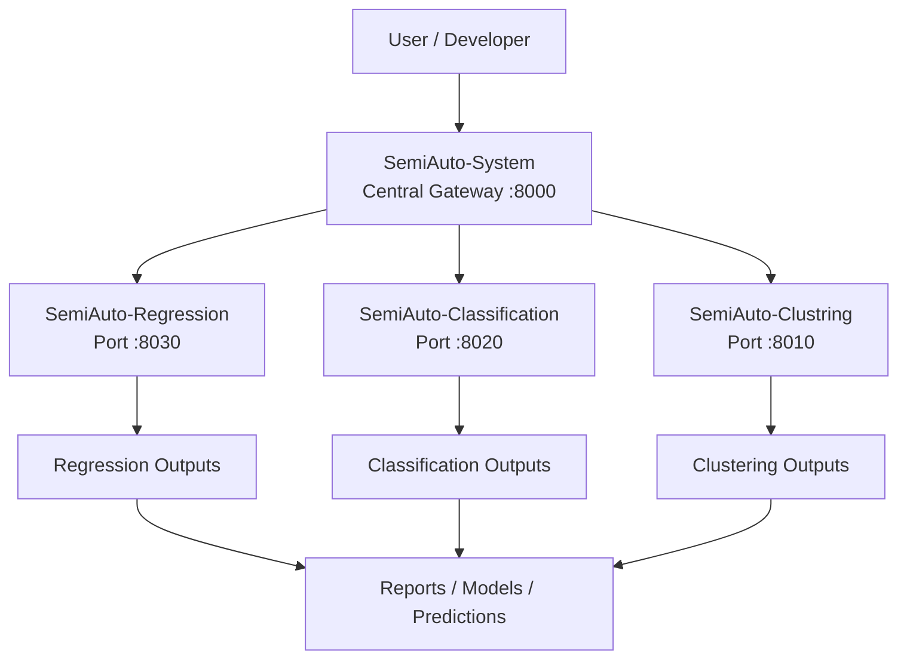
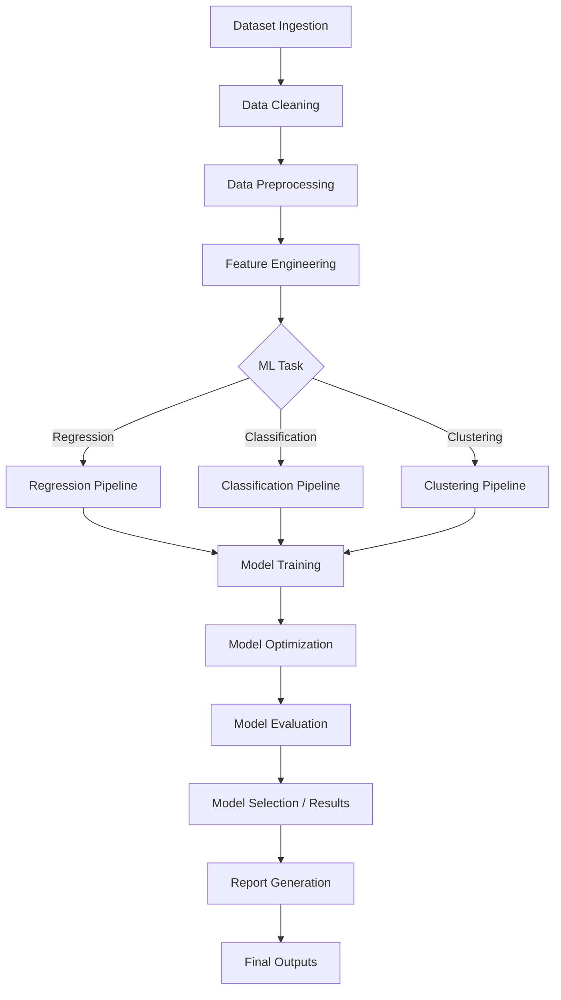

 <div align="center">

# SemiAuto

**A Modular, Semi-Automated Machine Learning Platform**

[](LICENSE)
[](https://www.python.org/)
[](https://fastapi.tiangolo.com/)
[](https://www.docker.com/)
[](#architecture)
[](#semi-auto-v20)


### Automating the Machine Learning Lifecycle, One Pipeline at a Time.

</div>

---

## Overview

**SemiAuto** is a modular, semi-automated Machine Learning platform designed to simplify and streamline the complete ML lifecycle, from raw dataset ingestion to trained models, predictions, evaluations, and generated reports.

Instead of building separate machine learning workflows for every problem, SemiAuto provides dedicated, independently deployable microservices for different machine learning tasks, all connected through a central orchestration gateway.

The platform combines user-controlled configurations with automated data processing, feature preparation, model training, optimization, evaluation, and reporting.

SemiAuto is designed for ML engineers, MLOps practitioners, data scientists, and software developers who want a flexible and extensible AutoML solution without losing control over the underlying machine learning process.

### The Vision

The objective behind SemiAuto is to build a production-oriented AutoML ecosystem that makes machine learning workflows more accessible, reproducible, modular, and scalable.

The platform currently consists of four interconnected components:

- **SemiAuto-Regression:** Automated supervised regression workflows.
- **SemiAuto-Classification:** Automated supervised classification workflows.
- **SemiAuto-Clustring:** Automated unsupervised clustering workflows.
- **SemiAuto-System:** Central orchestration gateway connecting all three ML services.

---

## Key Features

| Capability | Description |
|---|---|
| Unified AutoML Platform | Integrates regression, classification, and clustering into one ecosystem |
| Microservices Architecture | Each ML pipeline operates as an independent service |
| End-to-End ML Lifecycle | Covers ingestion, cleaning, preprocessing, training, evaluation, and reporting |
| Semi-Automated Workflows | Combines automated processing with user-defined configurations |
| Data Preprocessing | Supports missing-value handling, duplicate management, transformations, scaling, and encoding |
| Feature Engineering | Supports automated feature preparation and Featuretools integration |
| Model Training | Provides dedicated model-building workflows for different ML tasks |
| Hyperparameter Optimization | Integrates Optuna and GridSearchCV |
| Class Imbalance Handling | Supports SMOTE, SMOTEENN, and SMOTETomek for classification |
| Model Explainability | Integrates SHAP for feature importance and model interpretation |
| Model Evaluation | Evaluates trained models using task-specific performance metrics |
| Automated Reporting | Generates model artifacts, evaluation summaries, and reports |
| REST API Integration | Provides FastAPI-based communication between services |
| Web Interfaces | Provides browser-based interfaces for interacting with ML pipelines |
| Containerization | Supports Docker and Docker Compose-based deployment |
| Extensible Architecture | Allows individual pipelines to be modified and extended independently |

---

## Architecture

### High-Level System Architecture

SemiAuto follows a microservices architecture in which each machine learning workflow is developed and deployed independently.

The SemiAuto-System acts as the central gateway, providing a unified entry point for users to access the different ML pipelines.



### System Components

#### 1. SemiAuto-System — Orchestration Gateway

The central integration layer responsible for connecting users with the appropriate machine learning microservice.

Responsibilities:

- Provides a unified web dashboard.
- Allows users to select between regression, classification, and clustering.
- Routes requests to the selected microservice.
- Proxies API requests and static assets.
- Provides a single entry point for the complete SemiAuto ecosystem.

#### 2. SemiAuto-Regression — Supervised Learning

An automated regression pipeline designed for predicting continuous numerical values.

Key capabilities:

- Dataset ingestion and preprocessing.
- Regression model training.
- Model evaluation and optimization.
- Ranked model leaderboard generation.
- Prediction and report generation.
- Trained model and preprocessing artifact management.

#### 3. SemiAuto-Classification — Supervised Learning

An automated classification pipeline designed for predicting categorical outcomes.

Key capabilities:

- Dataset ingestion with target-column selection.
- Data cleaning and preprocessing.
- Feature engineering.
- Class imbalance handling.
- Classification model training.
- Hyperparameter optimization.
- Model evaluation and explainability.
- Prediction and report generation.

#### 4. SemiAuto-Clustring — Unsupervised Learning

An automated clustering pipeline designed to discover patterns and structures in unlabeled datasets.

Key capabilities:

- Dataset ingestion without requiring target labels.
- Data preprocessing and feature preparation.
- Clustering model building.
- Cluster assignment.
- Unsupervised model evaluation.
- Evaluation report and visualization generation.

---

## Machine Learning Lifecycle

SemiAuto aims to automate the major stages involved in developing and evaluating machine learning models.



### Supported ML Workflows

| Workflow | Learning Type | Primary Objective |
|---|---|---|
| Regression | Supervised Learning | Predict continuous numerical values |
| Classification | Supervised Learning | Predict categorical classes |
| Clustering | Unsupervised Learning | Discover groups and patterns in unlabeled data |

---

## Technology Stack

SemiAuto is built using Python and a collection of machine learning, backend, and deployment technologies.

| Category | Technologies |
|---|---|
| Programming Language | Python |
| Backend Framework | FastAPI |
| Machine Learning | Scikit-learn |
| Gradient Boosting | XGBoost, LightGBM, CatBoost |
| Hyperparameter Optimization | Optuna, GridSearchCV |
| Feature Engineering | Featuretools |
| Explainable AI | SHAP |
| Imbalanced Learning | SMOTE, SMOTEENN, SMOTETomek |
| Frontend | HTML, CSS, JavaScript |
| Templating | Jinja2 |
| Containerization | Docker, Docker Compose |
| Deployment | Ubuntu Server, Cloudflare Tunnel |
| Orchestration | Kubernetes |

---

## Repository Structure

The main SemiAuto repository integrates the individual microservice repositories while preserving their independent development histories.

```text
SemiAuto/
│
├── SemiAuto-System/
│   ├── app.py
│   ├── templates/
│   ├── Dockerfile
│   └── README.md
│
├── SemiAuto-Regression/
│   ├── app.py
│   ├── semiauto_regression/
│   ├── config/
│   ├── data/
│   ├── model/
│   ├── reports/
│   ├── templates/
│   ├── static/
│   ├── Dockerfile
│   └── README.md
│
├── SemiAuto-Classification/
│   ├── app.py
│   ├── semiauto_classification/
│   ├── config/
│   ├── data/
│   ├── reports/
│   ├── templates/
│   ├── static/
│   ├── Dockerfile
│   └── README.md
│
├── SemiAuto-Clustring/
│   ├── app.py
│   ├── semiauto_clustering/
│   ├── config/
│   ├── data/
│   ├── reports/
│   ├── templates/
│   ├── static/
│   ├── Dockerfile
│   └── README.md
│
├── docker-compose.yml
├── LICENSE
└── README.md
```

*The structure above illustrates the overall organization of the platform. Individual microservice directories contain their own implementation files and dependencies.*

---

## Installation & Deployment

### Prerequisites

- Python 3.10 or later.
- Git.
- Docker.
- Docker Compose (for full-stack deployment).
- Ubuntu/Linux environment (for server deployment).

### Clone the Repository

```bash
git clone https://github.com/Akshat-Sharma-110011/SemiAuto.git

cd SemiAuto
```

### Run Individual Microservices

Each microservice can be installed and executed independently.

| Service | Default Port | Application |
|---|---:|---|
| SemiAuto-System | 8000 | Orchestration Gateway |
| SemiAuto-Regression | 8030 | Regression Pipeline |
| SemiAuto-Classification | 8020 | Classification Pipeline |
| SemiAuto-Clustring | 8010 | Clustering Pipeline |

### Docker Deployment

Each microservice includes its own Dockerfile.

Build the individual images:

```bash
docker build -t semiauto-regression ./SemiAuto-Regression

docker build -t semiauto-classification ./SemiAuto-Classification

docker build -t semiauto-clustering ./SemiAuto-Clustring

docker build -t semiauto-system ./SemiAuto-System
```

### Docker Network

Create a shared Docker network:

```bash
docker network create semiauto-net
```

Run the microservices on the shared network using their configured service names.

The central gateway communicates with the individual microservices through internal Docker networking.

### Access the Platform

Once the services are running:

```text
SemiAuto-System:        http://localhost:8000/
SemiAuto-Regression:    http://localhost:8030/
SemiAuto-Classification: http://localhost:8020/
SemiAuto-Clustring:     http://localhost:8010/
```

---

## Development Philosophy

### Built to Understand, Not Just to Generate

SemiAuto is a learning-driven engineering project.

The codebase has been **primarily handwritten and developed through direct implementation**, with an emphasis on understanding the underlying concepts rather than relying on generated code.

The development philosophy focuses on:

- Writing and understanding the core implementation.
- Learning machine learning algorithms through practical implementation.
- Understanding the complete ML lifecycle.
- Applying object-oriented programming and modular software architecture.
- Learning how independent microservices communicate.
- Understanding containerization and deployment workflows.
- Debugging and resolving real-world engineering problems.
- Building systems through experimentation, iteration, and continuous learning.

**AI-assisted development has been kept to a minimum**, with almost no reliance on AI-generated code for the purpose of learning and understanding the technologies involved.

The intention is not simply to create an AutoML application, but to understand the engineering, mathematics, machine learning concepts, and deployment principles behind building one.

---

## SemiAuto V2.0 — The Next Evolution

<kbd>IN DEVELOPMENT</kbd>

SemiAuto V2.0 is planned as a major evolution of the existing platform.

While the current version focuses on semi-automating conventional machine learning workflows through configurable pipelines, V2.0 aims to introduce **Meta-Heuristic Learning** to explore more intelligent and adaptive optimization strategies.

### What's Coming in V2.0?

#### Meta-Heuristic Learning

The next version aims to explore meta-heuristic optimization approaches for improving the search and optimization process across machine learning workflows.

Potential research and implementation directions include:

- Population-based optimization.
- Nature-inspired optimization techniques.
- Intelligent hyperparameter search.
- Automated feature selection.
- Adaptive model configuration.
- Optimization of machine learning pipeline components.

#### Evolution of the Platform

| Current SemiAuto | Planned SemiAuto V2.0 |
|---|---|
| Semi-automated ML workflows | More intelligent optimization-driven workflows |
| Conventional hyperparameter optimization | Meta-heuristic optimization strategies |
| User-configured pipeline parameters | Exploration of adaptive configuration |
| Traditional model selection | Research into optimization-driven model selection |
| Independent ML pipelines | Further evolution of integrated AutoML workflows |

*These are development directions, not claims that the functionality is already implemented.*

### The Long-Term Vision

The long-term objective is to evolve SemiAuto beyond conventional AutoML by exploring intelligent optimization techniques that can improve how machine learning pipelines are configured, trained, and optimized.

---

## Limitations

The current implementation has several areas that can be improved:

- Individual microservices require independent execution and configuration.
- Advanced distributed processing is not yet established.
- Production-grade authentication and authorization need further development.
- Integrated experiment tracking and model versioning require further development.
- Automated pipeline optimization has room for improvement.
- Advanced monitoring and model drift detection are future considerations.
- Meta-heuristic learning is planned for V2.0 and is not part of the current implementation.

---

## Roadmap

- [x] Independent regression microservice.
- [x] Independent classification microservice.
- [x] Independent clustering microservice.
- [x] Central orchestration gateway.
- [x] REST API integration.
- [x] Docker support for individual services.
- [x] Unified platform architecture.
- [ ] Advanced Docker Compose deployment.
- [ ] Expanded Kubernetes deployment.
- [ ] Experiment tracking and model versioning.
- [ ] Advanced MLOps integration.
- [ ] SemiAuto V2.0.
- [ ] Meta-heuristic optimization integration.
- [ ] Intelligent and adaptive AutoML workflows.

---

## Related Projects

| Repository | Description |
|---|---|
| [SemiAuto-System](https://github.com/Akshat-Sharma-110011/SemiAuto-System) | Central gateway and microservice orchestration |
| [SemiAuto-Regression](https://github.com/Akshat-Sharma-110011/SemiAuto-Regression) | Automated regression pipeline |
| [SemiAuto-Classification](https://github.com/Akshat-Sharma-110011/SemiAuto-Classification) | Automated classification pipeline |
| [SemiAuto-Clustring](https://github.com/Akshat-Sharma-110011/SemiAuto-Clustring) | Automated unsupervised clustering pipeline |

---

## Contributing

Contributions, suggestions, and improvements are welcome.

1. Fork the repository.
2. Create a feature branch.
3. Implement your changes.
4. Test your implementation.
5. Submit a pull request.

For major changes, open an issue first to discuss the proposed implementation.

---

## License

Distributed under the [MIT License](LICENSE).

---

## Acknowledgments & References

SemiAuto builds upon the broader machine learning and AutoML ecosystem.

- [Scikit-learn](https://scikit-learn.org/) — Machine learning algorithms and tools.
- [H2O AutoML](https://docs.h2o.ai/h2o/latest-stable/h2o-docs/automl.html) — Automated machine learning and model selection.
- [XGBoost](https://xgboost.readthedocs.io/) — Gradient boosting framework.
- [LightGBM](https://lightgbm.readthedocs.io/) — Gradient boosting framework.
- [CatBoost](https://catboost.ai/) — Gradient boosting library.
- [Optuna](https://optuna.org/) — Hyperparameter optimization.
- [SHAP](https://shap.readthedocs.io/) — Model explainability.
- [Featuretools](https://www.featuretools.com/) — Automated feature engineering.

---

<div align="center">

# SemiAuto

**From Data to Intelligence.**

*Building, Understanding, Automating.*

**V1.0 — Building the Foundation**

**V2.0 — Exploring Meta-Heuristic Learning**

</div>
