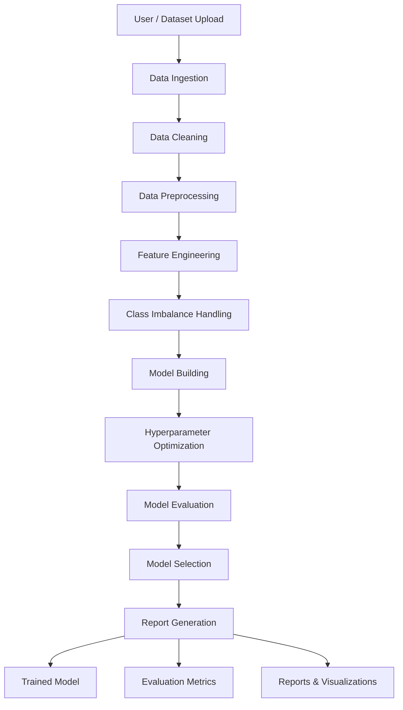
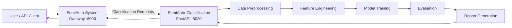

 <div align="center">

# SemiAuto-Classification

**Automated Machine Learning Microservice for Classification Workflows**

[](LICENSE)
[](https://www.python.org/)
[](https://fastapi.tiangolo.com/)
[](https://www.docker.com/)
[](https://scikit-learn.org/)


</div>

## Overview

**SemiAuto-Classification** is an automated machine learning microservice designed to streamline the complete **supervised classification lifecycle**. It automates data ingestion, cleaning, preprocessing, feature preparation, model training, evaluation, and report generation while allowing users to configure important parameters and control the ML workflow.

The platform follows a semi-automated approach, combining user-defined configurations with automated model selection and hyperparameter optimization to simplify the development of classification models.

It is designed for ML engineers, MLOps practitioners, and software developers who want a modular, configurable, and automated solution for classification problems.

SemiAuto-Classification also operates as an independent microservice within the larger **SemiAuto AutoML platform**, integrating with the central SemiAuto-System orchestration gateway.

## Key Features

| Capability | Description |
| --- | --- |
| End-to-End ML Pipeline | Automates data cleaning, preprocessing, training, evaluation, and reporting |
| Semi-Automated Design | Combines user configurations with automated machine learning operations |
| Data Preprocessing | Handles missing values, duplicates, transformations, scaling, and encoding |
| Feature Engineering | Supports automated feature preparation and feature engineering workflows |
| Class Imbalance Handling | Supports techniques such as SMOTE, SMOTEENN, and SMOTETomek |
| Model Building | Provides a modular structure for implementing and training classification algorithms |
| Hyperparameter Optimization | Supports optimization through techniques such as Optuna and GridSearchCV |
| Model Evaluation | Evaluates models using classification performance metrics |
| Explainable AI | Supports SHAP-based feature importance and model interpretability |
| Report Generation | Generates trained models, evaluation results, and reports |
| REST API | Exposes pipeline functionality through FastAPI endpoints |
| Web Dashboard | Provides a browser-based interface for interacting with the pipeline |
| Container Support | Includes Docker configuration for reproducible deployments |
| Microservice Integration | Integrates with SemiAuto-System as an independent classification service |

## Architecture

### Pipeline Overview



### Microservice Architecture

SemiAuto-Classification operates as an independent FastAPI microservice within the SemiAuto ecosystem.



### Processing Workflow

1. **Data Ingestion:** Accepts user-provided datasets in CSV format and identifies the target column.
2. **Data Cleaning:** Identifies data inconsistencies and prepares the dataset for subsequent processing.
3. **Data Preprocessing:** Handles missing values, duplicates, skewness, scaling, and categorical encoding.
4. **Feature Engineering:** Applies feature engineering techniques to improve the quality of input features.
5. **Class Imbalance Handling:** Provides techniques such as SMOTE, SMOTEENN, and SMOTETomek to address imbalanced datasets.
6. **Model Building:** Trains classification models using the configured machine learning workflow.
7. **Hyperparameter Optimization:** Uses Optuna and GridSearchCV for model optimization.
8. **Model Evaluation:** Evaluates trained models using classification performance metrics.
9. **Model Selection:** Identifies suitable models based on evaluation results.
10. **Report Generation:** Produces trained model artifacts, evaluation summaries, and visualizations.

### Repository Structure

```text
SemiAuto-Classification/
├── app.py                       # FastAPI application entry point
├── semiauto_classification/     # Core classification pipeline modules
│   ├── data_preprocessing.py    # Data cleaning and preprocessing
│   ├── model_building.py        # Classification model implementation
│   ├── model_evaluation.py      # Model evaluation
│   └── ...                      # Additional pipeline modules
├── config/                      # Pipeline configuration files
├── data/                        # Raw and processed datasets
├── reports/                     # Generated reports and model artifacts
├── templates/                   # HTML templates for web interface
├── static/                      # CSS, JavaScript, and static assets
├── requirements.txt             # Python dependencies
├── Dockerfile                   # Docker image configuration
├── test_environment.py          # Dependency validation script
├── LICENSE
└── README.md
```

## Installation

### Prerequisites

- Python 3.10 or later
- pip
- Git
- Docker (optional)
- Docker Compose (optional, for full-platform deployment)

### Install from Source

```bash
git clone https://github.com/Akshat-Sharma-110011/SemiAuto-Classification.git

cd SemiAuto-Classification

python -m venv venv
```

Activate the virtual environment:

```bash
# Windows
venv\Scripts\activate

# Linux / macOS
source venv/bin/activate
```

Install dependencies:

```bash
pip install -r requirements.txt
pip install -e .
```

### Install via pip

```bash
pip install semiauto-classification
```

### Validate Installation

Run the environment validation scripts:

```bash
python check_environment.py
python test_environment.py
```

### Docker Setup

Build the Docker image:

```bash
docker build -t semiauto-classification .
```

Run the container:

```bash
docker run -d \
    --name semiauto-classification \
    -p 8020:8020 \
    semiauto-classification
```

Check the running container:

```bash
docker ps
```

## Usage

### Launch the Application

Start the application:

```bash
python app.py
```

Alternatively, launch using Uvicorn:

```bash
uvicorn app:app --reload --host 0.0.0.0 --port 8020
```

### Web Dashboard

Once the application is running, access the web interface:

```text
http://localhost:8020/
```

The dashboard provides a user-facing interface for interacting with the classification pipeline and configuring the machine learning workflow.

### REST API

SemiAuto-Classification exposes its functionality through REST API endpoints.

FastAPI interactive documentation:

```text
http://localhost:8020/docs
```

### API Endpoints

| Method | Endpoint | Description |
| --- | --- | --- |
| POST | `/train` | Trigger classification model training |
| POST | `/predict` | Generate predictions for new samples |
| GET | `/report` | Retrieve or download the evaluation report |

### Example: Train a Classification Model

```bash
curl -X POST http://localhost:8020/train \
     -F "file=@data.csv" \
     -F "target=LabelColumn"
```

### Example: Generate Predictions

```bash
curl -X POST http://localhost:8020/predict \
     -F "file=@new_data.csv"
```

*Note: These examples follow the endpoint conventions provided in the project description. Verify the actual request parameter names against the running API documentation.*

### Outputs

The classification pipeline generates:

- Trained classification models.
- Model evaluation metrics.
- Confusion matrix.
- Accuracy, precision, recall, and other classification metrics.
- Generated reports and visualizations.

Outputs are stored under the `reports/` directory.

## Configuration & Customization

SemiAuto-Classification follows a modular architecture, making it easier to extend individual stages of the machine learning lifecycle.

- **Model Integration:** Extend `model_building.py` to introduce additional classification algorithms.
- **Data Preprocessing:** Modify `data_preprocessing.py` to introduce custom cleaning, transformation, scaling, and encoding techniques.
- **Class Imbalance Handling:** Configure imbalance-handling techniques according to dataset characteristics.
- **Hyperparameter Optimization:** Customize Optuna and GridSearchCV optimization strategies.
- **Feature Engineering:** Extend feature preparation and engineering workflows.
- **Model Evaluation:** Introduce additional classification evaluation metrics.
- **Configuration Management:** Modify configuration files such as `intel.yaml` to customize pipeline behavior.
- **Web Interface:** Customize HTML templates and frontend assets inside `templates/` and `static/`.

## Limitations

- Currently focused on supervised classification workflows.
- Model performance depends on dataset quality and preprocessing configurations.
- Multi-label classification support is not established as a current feature.
- Advanced automated ensembling is not established as a current feature.
- Integrated model monitoring and production drift detection are not currently included.
- Dedicated experiment tracking and model versioning are not currently integrated.

## Roadmap

- [ ] Multi-label classification support.
- [ ] Advanced automated feature engineering.
- [ ] Enhanced model selection and ensembling.
- [ ] Improved evaluation and reporting dashboard.
- [ ] MLflow integration for experiment tracking.
- [ ] Model versioning and lifecycle management.
- [ ] Production model monitoring and drift detection.
- [ ] Cloud-native and distributed deployment support.
- [ ] Enhanced Kubernetes deployment support.

## Related Projects

SemiAuto-Classification is part of the larger SemiAuto AutoML ecosystem.

| Project | Description |
| --- | --- |
| [SemiAuto-System](https://github.com/Akshat-Sharma-110011/SemiAuto-System) | Central orchestration gateway connecting all ML microservices |
| [SemiAuto-Regression](https://github.com/Akshat-Sharma-110011/SemiAuto-Regression) | Automated regression machine learning pipeline |
| [SemiAuto-Clustring](https://github.com/Akshat-Sharma-110011/SemiAuto-Clustring) | Automated unsupervised clustering machine learning pipeline |
| **SemiAuto-Classification** | Automated supervised classification machine learning pipeline |

## Contributing

Contributions are welcome!

1. Fork the repository.
2. Create a new feature branch.
3. Implement your changes.
4. Commit and push your changes.
5. Open a pull request.

For major changes, open an issue first to discuss the proposed modifications.

## License

Distributed under the [MIT License](LICENSE).

## Acknowledgments

- [Scikit-learn](https://scikit-learn.org/) for its comprehensive machine learning ecosystem.
- [H2O AutoML](https://docs.h2o.ai/h2o/latest-stable/h2o-docs/automl.html) for its model leaderboard-based selection and automation approach.
- [AutoML: A Survey of the State-of-the-Art](https://arxiv.org/abs/1904.12054) — Hutter et al., 2019.

---

<div align="center">

**SemiAuto — Simplifying the Machine Learning Lifecycle**

Part of the SemiAuto AutoML Platform.

</div>
