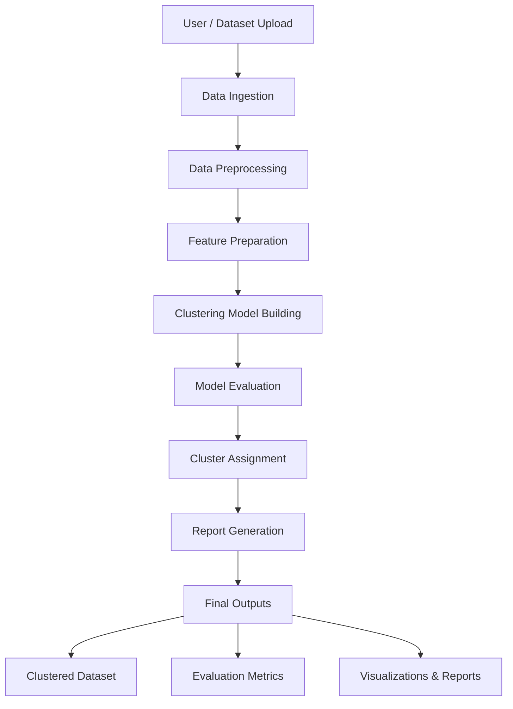
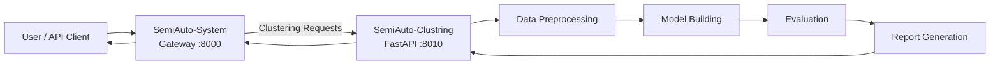

 <div align="center">

# SemiAuto-Clustring

**Automated Unsupervised Machine Learning Pipeline for Clustering Workflows**

[](LICENSE)
[](https://www.python.org/)
[](https://fastapi.tiangolo.com/)
[](https://www.docker.com/)
[](https://scikit-learn.org/)


</div>

## Overview

**SemiAuto-Clustring** is an automated machine learning microservice designed to streamline the complete **unsupervised clustering workflow**. It automates data ingestion, preprocessing, feature preparation, clustering model training, evaluation, and report generation while allowing users to configure important parameters and control the pipeline.

Unlike traditional clustering workflows that require extensive manual experimentation, SemiAuto-Clustring provides a semi-automated approach that simplifies the process of discovering meaningful patterns and structures in unlabeled datasets.

The project is designed for ML engineers, MLOps practitioners, and software developers who want a flexible, modular, and automated solution for unsupervised machine learning.

It also operates as an independent microservice within the larger **SemiAuto AutoML platform**, allowing it to integrate with the central SemiAuto-System orchestration gateway.

## Key Features

| Capability | Description |
| --- | --- |
| End-to-End Clustering Pipeline | Automates data ingestion, preprocessing, model training, evaluation, and reporting |
| Unsupervised Learning | Works with unlabeled datasets without requiring a target column |
| Semi-Automated Configuration | Allows users to control important clustering parameters while automating the ML workflow |
| Data Preprocessing | Handles data preparation and preprocessing before model training |
| Model Building | Provides a modular structure for implementing and training clustering algorithms |
| Model Evaluation | Evaluates clustering performance using appropriate unsupervised learning metrics |
| Report Generation | Generates structured outputs, evaluation results, and visualizations |
| Web Interface | Provides browser-based interaction with the clustering pipeline |
| REST API | Exposes pipeline functionality through FastAPI endpoints |
| Modular Architecture | Separates preprocessing, model building, evaluation, and reporting components |
| Container Support | Includes Docker configuration for independent deployment |
| Microservice Integration | Integrates with SemiAuto-System through its clustering service interface |

## Architecture

### Pipeline Overview



### Microservice Architecture

SemiAuto-Clustring operates as an independent FastAPI microservice within the SemiAuto ecosystem.



### Processing Workflow

1. **Data Ingestion:** Accepts user-provided datasets in CSV format.
2. **Data Preprocessing:** Prepares the dataset for clustering and handles data inconsistencies.
3. **Feature Preparation:** Processes the available features for unsupervised learning.
4. **Model Building:** Executes the clustering workflow using the configured model parameters.
5. **Model Evaluation:** Evaluates clustering results using unsupervised evaluation metrics.
6. **Cluster Assignment:** Produces cluster labels for the input observations.
7. **Report Generation:** Produces evaluation summaries, processed datasets, and relevant visualizations.

### Repository Structure

```text
SemiAuto-Clustring/
├── app.py                     # FastAPI application entry point
├── semiauto_clustering/       # Core clustering pipeline modules
│   ├── data_preprocessing.py  # Data preprocessing operations
│   ├── model_building.py      # Clustering model implementation
│   ├── evaluation.py          # Clustering evaluation
│   └── ...                    # Additional pipeline modules
├── config/                    # Pipeline configuration files
├── data/                      # Raw and processed datasets
├── reports/                   # Generated reports and visualizations
├── templates/                 # HTML templates for web interface
├── static/                    # CSS, JavaScript, and static assets
├── Dockerfile                 # Docker image configuration
├── requirements.txt           # Python dependencies
├── Makefile                   # Common development commands
├── LICENSE
└── README.md
```

## Installation

### Prerequisites

- Python 3.10 or later
- pip
- Git
- Docker (optional)
- Docker Compose (optional, for full-platform deployment)

### Local Setup

```bash
git clone https://github.com/Akshat-Sharma-110011/SemiAuto-Clustring.git

cd SemiAuto-Clustring

python -m venv venv
```

Activate the virtual environment:

```bash
# Windows
venv\Scripts\activate

# Linux / macOS
source venv/bin/activate
```

Install dependencies:

```bash
pip install -r requirements.txt
```

### Running the Application

Start the FastAPI application:

```bash
uvicorn app:app --reload --host 0.0.0.0 --port 8010
```

The application will be accessible at:

```text
http://localhost:8010/
```

FastAPI interactive API documentation:

```text
http://localhost:8010/docs
```

### Docker Setup

Build the Docker image:

```bash
docker build -t semiauto-clustering .
```

Run the container:

```bash
docker run -d \
    --name semiauto-clustering \
    -p 8010:8010 \
    semiauto-clustering
```

Check the running container:

```bash
docker ps
```

## Usage

### Web Interface

Once the application is running, open:

```text
http://localhost:8010/
```

The web interface provides access to the clustering workflow, allowing users to interact with the pipeline and submit datasets for processing.

### REST API

SemiAuto-Clustring exposes its functionality through FastAPI.

Open the interactive API documentation:

```text
http://localhost:8010/docs
```

The Swagger interface provides access to the available endpoints and their request parameters.

### Input & Output

| Type | Description |
| --- | --- |
| Input | CSV dataset containing feature columns |
| Target Column | Not required (unsupervised learning) |
| Processed Data | Preprocessed dataset ready for clustering |
| Cluster Labels | Assigned cluster labels for individual observations |
| Evaluation | Clustering performance metrics |
| Reports | Generated evaluation summaries and visualizations |

## Configuration & Customization

SemiAuto-Clustring follows a modular architecture that makes it easier to extend and customize individual stages of the clustering lifecycle.

- **Data Preprocessing:** Extend `data_preprocessing.py` to introduce additional preprocessing and transformation techniques.
- **Model Building:** Modify `model_building.py` to integrate new clustering algorithms and model configurations.
- **Evaluation Metrics:** Extend `evaluation.py` to introduce additional clustering evaluation techniques.
- **Configuration Management:** Modify configuration files to control pipeline parameters and execution behavior.
- **Report Generation:** Customize reporting components to introduce additional evaluation summaries and visualizations.
- **Microservice Integration:** Update service configuration when deploying through Docker networking or Kubernetes.

## Limitations

- Clustering performance depends on the quality and characteristics of the input dataset.
- Unsupervised learning does not provide ground-truth labels for direct evaluation.
- Large datasets may require additional memory and computational resources.
- Clustering algorithms can produce different results depending on their configurations and input data.
- Distributed processing and large-scale dataset support are not established features of the current implementation.
- Dedicated experiment tracking and model versioning are not currently integrated.

## Roadmap

- [ ] Additional clustering algorithms and model configurations.
- [ ] Automated optimal cluster-count selection.
- [ ] Advanced clustering evaluation and comparison.
- [ ] Enhanced clustering visualizations.
- [ ] Experiment tracking and model versioning.
- [ ] Distributed processing for large datasets.
- [ ] Enhanced API documentation and web interface.
- [ ] Extended MLOps integration.
- [ ] Improved Kubernetes deployment support.

## Related Projects

SemiAuto-Clustring is part of the larger SemiAuto AutoML ecosystem.

| Project | Description |
| --- | --- |
| [SemiAuto-System](https://github.com/Akshat-Sharma-110011/SemiAuto-System) | Central orchestration gateway connecting all ML microservices |
| [SemiAuto-Regression](https://github.com/Akshat-Sharma-110011/SemiAuto-Regression) | Automated regression machine learning pipeline |
| [SemiAuto-Classification](https://github.com/Akshat-Sharma-110011/SemiAuto-Classification) | Automated classification machine learning pipeline |
| **SemiAuto-Clustring** | Automated unsupervised clustering machine learning pipeline |

## Contributing

Contributions are welcome!

1. Fork the repository.
2. Create a new feature branch.
3. Implement your changes.
4. Commit and push your changes.
5. Open a pull request.

For major changes, open an issue first to discuss the proposed modifications.

## License

Distributed under the [MIT License](LICENSE).

## Acknowledgments

- [Scikit-learn](https://scikit-learn.org/) for its comprehensive machine learning and clustering ecosystem.
- [H2O AutoML](https://docs.h2o.ai/h2o/latest-stable/h2o-docs/automl.html) for its approach to automated machine learning.
- The AutoML research community for contributions toward automating unsupervised machine learning workflows.

---

<div align="center">

**SemiAuto — Simplifying the Machine Learning Lifecycle**

Part of the SemiAuto AutoML Platform.

</div>
