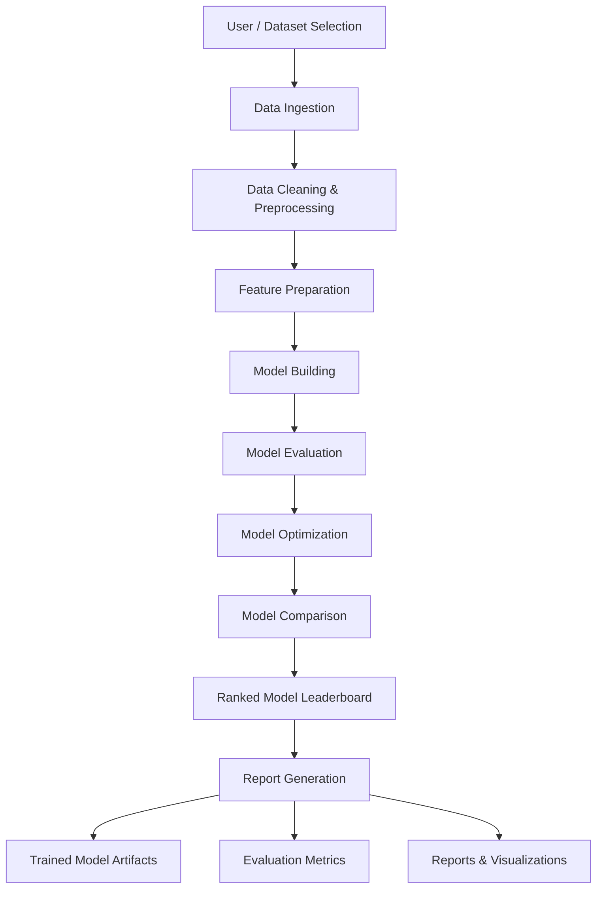
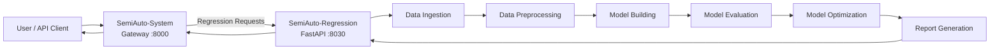

 <div align="center">

# SemiAuto-Regression

**Automated Machine Learning Microservice for Regression Workflows**

[](LICENSE)
[](https://www.python.org/)
[](https://fastapi.tiangolo.com/)
[](https://www.docker.com/)
[](https://scikit-learn.org/)


</div>

## Overview

**SemiAuto-Regression** is an automated machine learning microservice designed to streamline the complete **supervised regression lifecycle**. It automates data ingestion, preprocessing, model training, evaluation, optimization, and report generation while allowing users to configure important parameters and control key stages of the ML workflow.

The platform follows a semi-automated approach, combining user-defined configurations with automated model training and evaluation. It also generates a ranked model leaderboard, helping users compare different regression algorithms and identify suitable models for their datasets.

The project is designed for ML engineers, MLOps practitioners, and software developers who want a modular, configurable, and automated solution for regression problems.

SemiAuto-Regression operates as an independent microservice within the larger **SemiAuto AutoML platform**, integrating with the central SemiAuto-System orchestration gateway.

## Key Features

| Capability | Description |
| --- | --- |
| End-to-End ML Pipeline | Automates data ingestion, preprocessing, training, evaluation, and reporting |
| Regression-Focused AutoML | Automates training and evaluation of multiple regression models |
| Model Leaderboard | Generates ranked model evaluation results for comparison |
| User-Guided Workflow | Combines automation with manual control over model selection and configurations |
| Data Ingestion | Supports structured dataset ingestion through the pipeline |
| Data Preprocessing | Handles data preparation and preprocessing operations |
| Model Building | Provides a modular architecture for implementing regression algorithms |
| Model Optimization | Supports model optimization and hyperparameter tuning workflows |
| Model Evaluation | Evaluates regression models using appropriate performance metrics |
| Report Generation | Produces evaluation summaries, reports, and model artifacts |
| REST API | Exposes pipeline functionality through FastAPI endpoints |
| Web Dashboard | Provides an HTML-based interface for interacting with the pipeline |
| Container Support | Includes Docker configuration for reproducible deployments |
| Microservice Integration | Integrates with SemiAuto-System as an independent regression service |

## Architecture

### Pipeline Overview



### Microservice Architecture

SemiAuto-Regression operates as an independent FastAPI microservice within the SemiAuto ecosystem.



### Processing Workflow

1. **Data Ingestion:** Loads the selected dataset and prepares it for regression modeling.
2. **Data Preprocessing:** Handles data cleaning, missing values, transformations, and feature preparation.
3. **Feature Preparation:** Prepares input features and target variables for model training.
4. **Model Building:** Trains multiple regression algorithms using the configured pipeline.
5. **Model Evaluation:** Evaluates trained models using regression performance metrics.
6. **Model Optimization:** Optimizes model configurations and hyperparameters.
7. **Model Comparison:** Compares model performance and generates a ranked leaderboard.
8. **Report Generation:** Produces evaluation reports, summaries, and trained model artifacts.

### Repository Structure

```text
SemiAuto-Regression/
├── app.py                       # FastAPI application entry point
├── config/                      # YAML/JSON configuration files
├── data/                        # Raw, interim, cleaned, and processed datasets
├── intel.yaml                   # Master configuration and control flags
├── model/                       # Trained models, encoders, and transformers
├── reports/                     # Generated evaluation and summary reports
├── requirements.txt             # Python dependencies
├── semiauto_regression/          # Core regression pipeline modules
│   ├── data_ingestion.py         # Dataset ingestion
│   ├── data_preprocessing.py     # Data cleaning and preprocessing
│   ├── model_building.py         # Regression model implementation
│   ├── model_evaluation.py       # Model evaluation
│   ├── model_optimization.py     # Hyperparameter optimization
│   └── projectflow_reports.py    # Pipeline reporting
├── static/                      # CSS, JavaScript, and static assets
├── templates/                   # Jinja2 HTML templates
├── tests/                       # Unit tests
├── Dockerfile                   # Docker image configuration
├── LICENSE
└── README.md
```

## Installation

### Prerequisites

- Python 3.10 or later
- pip
- Git
- Docker (optional)
- Required system libraries for supported ML dependencies, such as `libgomp1` where applicable

### Install from Source

```bash
git clone https://github.com/Akshat-Sharma-110011/SemiAuto-Regression.git

cd SemiAuto-Regression

python -m venv venv
```

Activate the virtual environment:

```bash
# Windows
venv\Scripts\activate

# Linux / macOS
source venv/bin/activate
```

Upgrade pip and install dependencies:

```bash
pip install --upgrade pip
pip install -r requirements.txt
```

### Docker Setup

Build the Docker image:

```bash
docker build -t semiauto-regression .
```

Run the container:

```bash
docker run -d \
    --name semiauto-regression \
    -p 8030:8030 \
    semiauto-regression
```

Check the running container:

```bash
docker ps
```

## Usage

### Launch the Application

Start the FastAPI application using Uvicorn:

```bash
uvicorn app:app --reload --host 0.0.0.0 --port 8030
```

### Web Dashboard

Once the application is running, access the web interface:

```text
http://localhost:8030/
```

The dashboard provides a user-facing interface for interacting with the regression pipeline, configuring model parameters, monitoring execution, and accessing generated reports.

### REST API

SemiAuto-Regression exposes its functionality through REST API endpoints.

FastAPI interactive documentation:

```text
http://localhost:8030/docs
```

### API Endpoints

| Method | Endpoint | Description |
| --- | --- | --- |
| POST | `/train` | Start the regression training pipeline |
| GET | `/status` | Retrieve training status |
| GET | `/predict` | Perform inference |
| GET | `/report` | Retrieve or download performance reports |

### Example: Start Model Training

```bash
curl -X POST http://localhost:8030/train \
     -H "Content-Type: application/json" \
     -d '{
         "dataset": "data_boston",
         "model": "catboost",
         "epochs": 50
     }'
```

### Outputs

The regression pipeline generates:

- Trained regression models.
- Model evaluation metrics.
- Ranked model leaderboard.
- Processed datasets and model artifacts.
- Evaluation summaries and performance reports.
- Encoders and preprocessing transformers.

Generated artifacts are organized under the `model/` and `reports/` directories.

## Configuration & Customization

SemiAuto-Regression follows a modular architecture, allowing users to customize individual stages of the regression lifecycle.

- **Pipeline Configuration:** Update `intel.yaml` to configure dataset selection, output paths, models, and pipeline control flags.
- **Dataset Management:** Add datasets under `data/raw/data_<name>/original.csv`.
- **Feature Metadata:** Extend `references/feature_store_<dataset>.yaml` to provide dataset-specific metadata.
- **Model Integration:** Extend `model_building.py` to introduce additional regression algorithms.
- **Model Evaluation:** Modify `model_evaluation.py` to introduce additional evaluation metrics and comparison strategies.
- **Model Optimization:** Customize optimization workflows through `model_optimization.py`.
- **Report Generation:** Extend `projectflow_reports.py` to customize generated reports.
- **Web Interface:** Customize HTML templates and frontend assets inside `templates/` and `static/`.

## Limitations

- Currently focused exclusively on supervised regression workflows.
- Model performance depends on dataset quality and preprocessing configurations.
- Advanced automated ensembling is not established as a current feature.
- Large-scale distributed machine learning is not currently supported.
- Integrated production monitoring and model drift detection are not currently included.
- Dedicated experiment tracking and model versioning are not currently integrated.

## Roadmap

- [ ] Advanced hyperparameter optimization.
- [ ] Improved automated feature engineering.
- [ ] Enhanced model selection and ensembling.
- [ ] MLflow integration for experiment tracking.
- [ ] DVC integration for data and model versioning.
- [ ] CI/CD integration for automated deployment.
- [ ] Airflow integration for workflow orchestration.
- [ ] Cloud-native pipeline deployment.
- [ ] Distributed machine learning support.
- [ ] Enhanced Kubernetes deployment support.

## Related Projects

SemiAuto-Regression is part of the larger SemiAuto AutoML ecosystem.

| Project | Description |
| --- | --- |
| [SemiAuto-System](https://github.com/Akshat-Sharma-110011/SemiAuto-System) | Central orchestration gateway connecting all ML microservices |
| [SemiAuto-Classification](https://github.com/Akshat-Sharma-110011/SemiAuto-Classification) | Automated supervised classification machine learning pipeline |
| [SemiAuto-Clustring](https://github.com/Akshat-Sharma-110011/SemiAuto-Clustring) | Automated unsupervised clustering machine learning pipeline |
| **SemiAuto-Regression** | Automated supervised regression machine learning pipeline |

## Contributing

Contributions are welcome!

1. Fork the repository.
2. Create a new feature branch.
3. Implement your changes.
4. Commit and push your changes.
5. Open a pull request.

For major changes, open an issue first to discuss the proposed modifications.

## License

Distributed under the [MIT License](LICENSE).

## Acknowledgments

- [Scikit-learn](https://scikit-learn.org/) for its comprehensive machine learning ecosystem.
- [H2O AutoML](https://docs.h2o.ai/h2o/latest-stable/h2o-docs/automl.html) for its leaderboard-based model selection and automation approach.
- [AutoML: A Survey of the State-of-the-Art](https://arxiv.org/abs/1904.12054) — K. Hutter et al., 2019.

---

<div align="center">

**SemiAuto — Simplifying the Machine Learning Lifecycle**

Part of the SemiAuto AutoML Platform.

</div>
