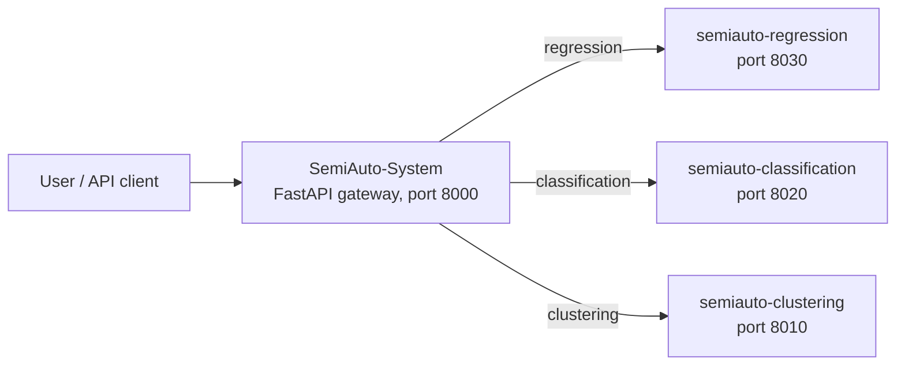
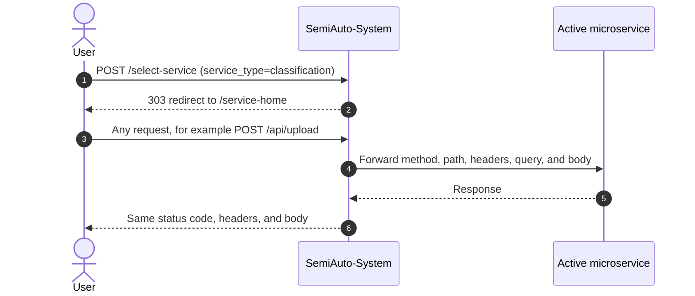

<div align="center">
# SemiAuto-System
 
**Unified orchestration gateway for the SemiAuto regression, classification, and clustering pipelines**
 
[](LICENSE)
[](https://www.python.org/)
[](https://fastapi.tiangolo.com/)
[](https://www.docker.com/)
[](#architecture)
 

</div>

 
## Overview
 
SemiAuto-System is the orchestration layer of the SemiAuto platform. It places a single FastAPI gateway in front of three independent machine learning microservices (regression, classification, and clustering) and forwards every request to the pipeline the user has selected. Clients talk to one address; service selection and request proxying are handled by the gateway.
 
The project is aimed at ML engineers, MLOps practitioners, and software developers who want several automated ML pipelines behind a single entry point while keeping each pipeline independently deployable and replaceable.
 
## Key Features
 
| Capability | Description |
| --- | --- |
| Unified entry point | One gateway for the regression, classification, and clustering pipelines |
| API-first with dashboard | Transparent REST proxying plus a web dashboard for choosing a pipeline |
| Modular microservices | Each pipeline runs as its own service and can be developed and deployed independently |
| Runtime pipeline switching | Change the active pipeline through user selection, without redeploying |
| Transparent proxying | API calls and static assets are forwarded to the active service, so responses appear to come from one system |
| Container support | Dockerfile included for containerized deployment |
 
## Architecture
 
### System Topology
 

 
### Request Flow
 

 
1. The user opens `/` and selects a pipeline.
2. The gateway records the selection as the active service.
3. All subsequent API and static-asset requests are proxied to that service.
4. The service response is returned unchanged, so the platform behaves as a single system.
### Microservices
 
| Service key | Repository | Default port | Purpose |
| --- | --- | --- | --- |
| `regression` | [SemiAuto-Regression](https://github.com/Akshat-Sharma-110011/SemiAuto/tree/main/SemiAuto-Regression) | 8030 | Regression pipeline |
| `classification` | [SemiAuto-Classification](https://github.com/Akshat-Sharma-110011/SemiAuto/tree/main/SemiAuto-Classification) | 8020 | Classification pipeline |
| `clustering` | [SemiAuto-Clustring](https://github.com/Akshat-Sharma-110011/SemiAuto/tree/main/SemiAuto-Clustring) | 8010 | Clustering pipeline |
 
### Repository Structure
 
```
SemiAuto-System/
├── app.py               # FastAPI gateway: service selection and request proxying
├── templates/
│   └── index.html       # Dashboard for choosing a pipeline
├── requirements.txt     # Python dependencies
├── Dockerfile           # Container build configuration
├── LICENSE
└── README.md
```
 
## Installation
 
### Prerequisites
 
- Python 3.10 or later (the Docker image uses Python 3.10)
- pip
- Running instances of the three microservices on ports 8030, 8020, and 8010 (see [Related Projects](#related-projects))
- Docker (optional)
> [!IMPORTANT]
> The gateway does not start or manage the microservices. Make sure they are running and reachable at the addresses configured in `MICROSERVICES` before you select a pipeline.
 
### Local Setup
 
```bash
git clone https://github.com/Akshat-Sharma-110011/SemiAuto-System.git
cd SemiAuto-System
python -m venv venv
source venv/bin/activate        # Windows: venv\Scripts\activate
pip install -r requirements.txt
uvicorn app:app --reload --port 8000
```
 
### Docker Setup
 
```bash
docker build -t semiauto-system .
docker run -p 8000:8000 semiauto-system
```
 
### Running the Full Stack with Docker
 
The default `MICROSERVICES` hostnames resolve only on a shared Docker network, so a gateway container started on its own cannot reach the pipelines. The commands below assume the four repositories are cloned side by side.
 
```bash
# Build one image per repository
docker build -t semiauto-regression     ./SemiAuto-Regression
docker build -t semiauto-classification ./SemiAuto-Classification
docker build -t semiauto-clustering     ./SemiAuto-Clustring
docker build -t semiauto-system         ./SemiAuto-System
 
# Create a shared network
docker network create semiauto-net
 
# Start the pipelines (container names must match the hostnames in MICROSERVICES)
docker run -d --name semiauto-regression     --network semiauto-net semiauto-regression
docker run -d --name semiauto-classification --network semiauto-net semiauto-classification
docker run -d --name semiauto-clustering     --network semiauto-net semiauto-clustering
 
# Start the gateway
docker run -d --name semiauto-system --network semiauto-net -p 8000:8000 semiauto-system
```
 
Only the gateway port needs to be published; it reaches the pipelines over the shared network. Open `http://localhost:8000/` once all containers are running.
 
## Usage
 
### Web Dashboard
 
Open the dashboard:
 
```
http://localhost:8000/
```
 
Select Regression, Classification, or Clustering. The gateway then redirects you to that service's interface.
 
### Gateway Routes
 
| Method | Route | Behavior |
| --- | --- | --- |
| GET | `/` | Dashboard for choosing a pipeline |
| POST | `/select-service` | Sets the active pipeline from the form field `service_type` (`regression`, `classification`, or `clustering`) and redirects to `/service-home`. Unknown values return 400 |
| GET | `/service-home` | Opens the active service's home page through the gateway. Redirects to `/` if no service is selected |
| GET | `/{service}-static/{path}` | Proxies static assets to the matching service, for example `/clustering-static/css/styles.css` |
| GET, POST, PUT, PATCH, DELETE | `/{path}` | Any other request is forwarded to the active service. Redirects to `/` if no service is selected |
 
Because every other path is forwarded, the full API of the selected service is available through the gateway. See the service repositories for their endpoints.
 
### Example: Select the Classification Pipeline
 
```bash
# 1. Select the pipeline
curl -X POST -F "service_type=classification" http://localhost:8000/select-service
 
# 2. Call the selected service through the gateway
curl -X POST http://localhost:8000/api/upload \
     -F "file=@your_data.csv" \
     -F "target_column=label"
```
 
### Error Handling
 
- If the active service cannot be reached, the gateway returns `503` with the message "`<Service>` microservice unavailable".
- Requests time out after 300 seconds, with 60 seconds allowed to establish the connection.
## Configuration
 
Service addresses are defined in `app.py`:
 
```python
MICROSERVICES = {
    "regression": "http://semiauto-regression:8030",
    "classification": "http://semiauto-classification:8020",
    "clustering": "http://semiauto-clustering:8010"
}
```
 
Adjust hostnames and ports to match your deployment (Docker network, Docker Compose, or Kubernetes).
 
> [!TIP]
> When the pipelines run directly on the host rather than in containers, replace the hostnames with `localhost`, for example `"http://localhost:8030"`.
 
## Limitations
 
- Microservices must be started and managed separately.
- The selected pipeline is stored in process memory and shared by every client, so only one pipeline is active at a time.
- No authentication or authorization.
- Minimal error handling and no retry logic.
- No experiment tracking or database integration.
- Limited to tabular supervised and unsupervised pipelines.
## Roadmap
 
- [ ] Additional pipeline types (NLP, time series)
- [ ] AutoML integration for parameter search
- [ ] Full MLOps lifecycle support (logging, versioning, monitoring)
- [ ] User authentication and access control
- [ ] Docker Compose or Helm chart for full orchestration
- [ ] Enhanced dashboard with drag-and-drop data and pipeline visualization
## Related Projects
 
| Project | Description |
| --- | --- |
| [SemiAuto-System](https://github.com/Akshat-Sharma-110011/SemiAuto-System) | Orchestration gateway (this repository) |
| [SemiAuto-Regression](https://github.com/Akshat-Sharma-110011/SemiAuto-Regression) | Regression pipeline microservice |
| [SemiAuto-Classification](https://github.com/Akshat-Sharma-110011/SemiAuto-Classification) | Classification pipeline microservice |
| [SemiAuto-Clustering](https://github.com/Akshat-Sharma-110011/SemiAuto-Clustring) | Clustering pipeline microservice (repository name: `SemiAuto-Clustring`) |
 
## Contributing
 
Contributions are welcome. Fork the repository, create a feature branch, commit your changes, and open a pull request. For larger changes, open an issue first to discuss the approach. Additional pipelines, visualization tools, and deployment recipes are especially valuable.
 
## License
 
Distributed under the [MIT License](LICENSE).
 
## Acknowledgments
 
- [H2O AutoML](https://docs.h2o.ai/h2o/latest-stable/h2o-docs/automl.html) for its streamlined, user-controllable approach to automation.
- Modular MLOps tooling, for its emphasis on pipeline separation, extensibility, and runtime orchestration.
 
